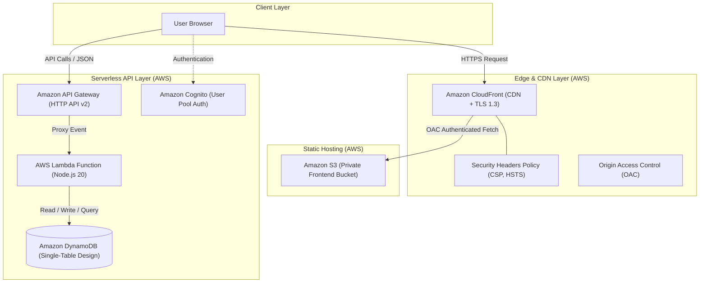

# CloudBoard ☁️🏆

[](https://nextjs.org/)
[](https://react.dev/)
[](https://www.typescriptlang.org/)
[](https://tailwindcss.com/)
[](https://aws.amazon.com/)
[](https://opensource.org/licenses/MIT)

> **CloudBoard** is a full-featured, serverless community engagement and contribution leaderboard platform built for the **AWS Student Builder Group**. It powers gamified member tracking, department performance metrics, attendance management, and point approvals backed by high-performance AWS cloud infrastructure.

---

## 🌟 Key Features

- **🏆 Dynamic Real-time Leaderboard**
  - Live calculated ranking, points breakdown, and performance badges.
  - Multi-dimensional filtering by department, category, and contribution timeframe.
- **⚡ Gamified Contribution & Points Workflow**
  - Multi-tier submission and approval system (Leader, Department Head, Core Team, Committee).
  - Detailed submission history, points timeline, and audit logs.
- **🏢 Department Performance Hub**
  - Analytics and breakdown for Engineering, Marketing & Design, Event Coordination, Budget & IO, and Delegate Handling.
- **👥 Member Profiles & Activity Metrics**
  - Rich member profile cards, achievements, activity stream, and contribution breakdowns.
- **🔒 Role-Based Access Control (RBAC)**
  - Seamless authentication and role-switching engine for testing and permission verification.
- **🚀 Serverless AWS Cloud Native Architecture**
  - Microsecond latency single-table DynamoDB design, AWS Lambda, API Gateway HTTP API, and CloudFront CDN edge caching.

---

## 🏗️ Architecture



---

## 📂 Project Structure

```text
CloudBoard/
├── cloudboard/                    # Frontend application
│   ├── app/                       # Next.js 15 App Router pages
│   │   ├── attendance/            # Attendance logging and tracking
│   │   ├── dashboard/             # Member & admin dashboard
│   │   ├── departments/           # Department breakdown and statistics
│   │   ├── dept-head/             # Department head management portal
│   │   ├── leader/                # Executive leader portal
│   │   ├── leaderboard/           # Public & internal ranking boards
│   │   ├── members/[id]/          # Member profile details
│   │   ├── submissions/           # Point submissions & approvals
│   │   └── page.tsx               # Primary landing dashboard
│   ├── components/                # Reusable UI components & modals
│   │   ├── auth/                  # AuthGuard, AuthModal, Login
│   │   ├── dashboard/             # ProfileCard, PointsBreakdown, Timeline
│   │   └── ui/                    # Skeleton loaders, Empty states
│   ├── lib/                       # Services, adapters, validations, and state
│   │   ├── services/adapters/aws/ # AWS API Gateway & DynamoDB adapters
│   │   ├── services/adapters/local/# Mock & fallback local data store
│   │   └── roleContext.tsx        # Dynamic RBAC provider
│   ├── buildspec.yml              # AWS CodeBuild CI/CD specification
│   ├── cloudfront-config.md       # Production CloudFront & S3 guide
│   └── tailwind.config.js         # Design system & theme tokens
│
├── backend-demo/                  # Serverless AWS backend
│   ├── index.mjs                  # AWS Lambda API router & DynamoDB client
│   ├── template.yaml              # AWS SAM / CloudFormation template
│   ├── batch_items.json           # DynamoDB seed dataset
│   └── seedDemoTable.mjs          # Direct DynamoDB table population utility
│
└── README.md                      # Project documentation
```

---

## ⚡ Tech Stack

| Domain | Technology |
|---|---|
| **Framework** | [Next.js 15 (App Router)](https://nextjs.org/) |
| **UI Library** | [React 19](https://react.dev/) |
| **Language** | [TypeScript 5](https://www.typescriptlang.org/) |
| **Styling** | [Tailwind CSS 3.4](https://tailwindcss.com/) |
| **Animations** | [Framer Motion](https://www.framer.com/motion/) |
| **Icons** | [Lucide React](https://lucide.dev/) |
| **Compute** | [AWS Lambda](https://aws.amazon.com/lambda/) (Node.js 20.x runtime) |
| **API** | [Amazon API Gateway HTTP API](https://aws.amazon.com/api-gateway/) |
| **Database** | [Amazon DynamoDB](https://aws.amazon.com/dynamodb/) (Single-Table Pattern) |
| **Hosting & CDN** | [Amazon S3](https://aws.amazon.com/s3/) + [Amazon CloudFront](https://aws.amazon.com/cloudfront/) |

---

## 🚀 Getting Started

### Prerequisites

- [Node.js](https://nodejs.org/) (v20.x or higher)
- [npm](https://www.npmjs.com/) (v10.x or higher)
- Optional: [AWS CLI](https://aws.amazon.com/cli/) configured with deployment permissions

### 1. Clone Repository

```bash
git clone https://github.com/bl4ckf0xk/CloudBoard.git
cd CloudBoard
```

### 2. Run the Frontend Locally

```bash
cd cloudboard

# Install dependencies
npm install

# Launch development server
npm run dev
```

Open [http://localhost:3000](http://localhost:3000) in your browser.

### 3. Build & Static Export

```bash
cd cloudboard
npm run build
```
This generates the optimized production build ready for Amazon S3 / CloudFront deployment.

---

## ☁️ Backend & Database Setup

The backend is built with AWS serverless services. You can deploy it using the provided SAM template:

```bash
cd backend-demo

# Deploy the SAM stack (Lambda + API Gateway + IAM Role)
sam deploy --guided
```

### Seeding DynamoDB

Populate sample data for members, departments, and points:

```bash
cd backend-demo

# Seed DynamoDB table
node seedDemoTable.mjs
```

### DynamoDB Single-Table Schema

| Entity | Partition Key (`PK`) | Sort Key (`SK`) | Attributes |
|---|---|---|---|
| **Member Profile** | `MEMBER#<user_id>` | `PROFILE` | `name`, `email`, `role`, `dept`, `total_points`, `avatar` |
| **Point Log** | `POINT#<point_id>` | `METADATA` | `target_user_id`, `submitted_by`, `points`, `category`, `status` |
| **Department** | `DEPT#<dept_id>` | `INFO` | `name`, `head_id`, `total_points`, `member_count` |

---

## 🛡️ Production Deployment & Security

Refer to [`cloudboard/cloudfront-config.md`](file:///cloudboard/cloudfront-config.md) for detailed instructions on:
- S3 Bucket creation with **Block Public Access**
- **CloudFront Origin Access Control (OAC)**
- HTTP Security Headers (`Content-Security-Policy`, `Strict-Transport-Security`, `X-Frame-Options`, `X-Content-Type-Options`)
- Single Page Application routing (403/404 &rarr; `/index.html`)

---

## 👨‍💻 Author

**Kavindu Alahakoon** ([@bl4ckf0xk](https://github.com/bl4ckf0xk))  
AWS Student Builder Group &mdash; Sri Lanka

---

## 📄 License

This project is licensed under the [MIT License](LICENSE).
